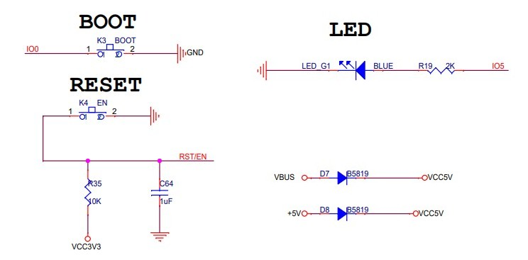
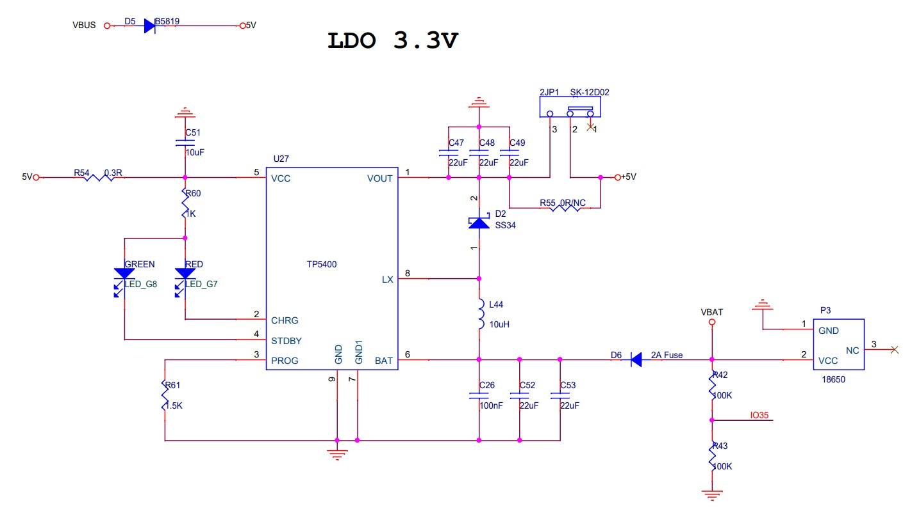

# T18


Software for the TTGO T18 3.0 20190410, also known as T-Energy.

## Documentation

LilyGo has some parts documented in this reposiory: [LILYGO-T-Energy](https://github.com/LilyGO/LILYGO-T-Energy).

The important details are:

- LED on pin IO5
- Battery on IO35 over 100K/100K voltage divider
- Button **EN** is also RESET or Enable
- Button **BOOT** is IO0

All from the schematics [https://github.com/LilyGO/LILYGO-T-Energy/blob/master/t18_v3.0.pdf](https://github.com/LilyGO/LILYGO-T-Energy/blob/master/t18_v3.0.pdf)

## Diagram

Buttons and LED:



Charge controller TP5400 LDO 3.3V, Voltage divider 100k/100k to IO35



## Status

Here is a short example status.ino program for this version

```c
// TTGO T18 (ESP32) status page
// - Connects to WiFi, reachable as http://T18.local/ (and by its IP)
// - Shows uptime, 18650 battery voltage and WiFi signal strength / quality
//
// Hardware:
//   Blue LED        : IO5
//   Battery divider : 100k / 100k from battery+ to GND, midpoint on IO35
//
// Board in Arduino IDE: "ESP32 Dev Module" (esp32 core 2.x or 3.x)

#include <WiFi.h>
#include <ESPmDNS.h>
#include <WebServer.h>

const char* WIFI_SSID     = "your-ssid";      // <-- fill in later
const char* WIFI_PASSWORD = "your-password";  // <-- fill in later
const char* HOSTNAME      = "T18";

const int LED_PIN = 5;    // blue LED
const int BAT_PIN = 35;   // battery voltage divider (input only pin)

const float DIVIDER_RATIO = 2.0;  // 100k/100k -> Vbat = 2 * Vpin
const int   ADC_SAMPLES   = 16;

WebServer server(80);

// ---------- helpers ----------

float readBatteryVoltage() {
  uint32_t sum = 0;
  for (int i = 0; i < ADC_SAMPLES; i++) {
    sum += analogReadMilliVolts(BAT_PIN);  // calibrated millivolts at the pin
    delay(2);
  }
  float pin_mV = sum / (float)ADC_SAMPLES;
  return pin_mV * DIVIDER_RATIO / 1000.0;
}

// Rough battery percentage for a single Li-ion cell (3.0 V empty, 4.2 V full)
int batteryPercent(float v) {
  int p = (int)((v - 3.0) / (4.2 - 3.0) * 100.0 + 0.5);
  return constrain(p, 0, 100);
}

// Common mapping: -50 dBm or better = 100 %, -100 dBm or worse = 0 %
int rssiToQuality(int rssi) {
  return constrain(2 * (rssi + 100), 0, 100);
}

String uptimeString(uint64_t seconds) {
  uint32_t d = seconds / 86400;
  uint32_t h = (seconds % 86400) / 3600;
  uint32_t m = (seconds % 3600) / 60;
  uint32_t s = seconds % 60;
  char buf[40];
  snprintf(buf, sizeof(buf), "%ud %02uh %02um %02us", d, h, m, s);
  return String(buf);
}

// ---------- web handlers ----------

const char PAGE[] PROGMEM = R"HTML(
<!DOCTYPE html>
<html lang="en">
<head>
<meta charset="utf-8">
<meta name="viewport" content="width=device-width, initial-scale=1">
<title>T18</title>
<style>
  body { font-family: system-ui, sans-serif; background:#111; color:#eee; margin:0; padding:1.5rem; }
  h1 { margin-top:0; }
  table { border-collapse: collapse; width:100%; max-width:28rem; }
  td { padding:.6rem .4rem; border-bottom:1px solid #333; }
  td:first-child { color:#9ab; }
  td:last-child { text-align:right; font-variant-numeric: tabular-nums; }
  .bar { height:.5rem; background:#333; border-radius:.25rem; margin-top:.3rem; }
  .bar > div { height:100%; background:#4af; border-radius:.25rem; }
</style>
</head>
<body>
<h1>T18</h1>
<table>
  <tr><td>Uptime</td><td id="uptime">-</td></tr>
  <tr><td>Battery</td>
      <td><span id="vbat">-</span> V (<span id="bpct">-</span> %)
          <div class="bar"><div id="bbar" style="width:0%"></div></div></td></tr>
  <tr><td>WiFi network</td><td id="ssid">-</td></tr>
  <tr><td>Signal strength</td><td><span id="rssi">-</span> dBm</td></tr>
  <tr><td>Signal quality</td>
      <td><span id="quality">-</span> %
          <div class="bar"><div id="qbar" style="width:0%"></div></div></td></tr>
  <tr><td>IP address</td><td id="ip">-</td></tr>
</table>
<script>
async function update() {
  try {
    const r = await fetch('/data');
    const d = await r.json();
    uptime.textContent  = d.uptime;
    vbat.textContent    = d.vbat.toFixed(2);
    bpct.textContent    = d.bpct;
    bbar.style.width    = d.bpct + '%';
    ssid.textContent    = d.ssid;
    rssi.textContent    = d.rssi;
    quality.textContent = d.quality;
    qbar.style.width    = d.quality + '%';
    ip.textContent      = d.ip;
  } catch (e) {}
}
update();
setInterval(update, 2000);
</script>
</body>
</html>
)HTML";

void handleRoot() {
  server.send_P(200, "text/html", PAGE);
}

void handleData() {
  float vbat = readBatteryVoltage();
  int rssi = WiFi.RSSI();

  String json = "{";
  json += "\"uptime\":\"" + uptimeString(millis() / 1000ULL) + "\",";
  json += "\"vbat\":" + String(vbat, 3) + ",";
  json += "\"bpct\":" + String(batteryPercent(vbat)) + ",";
  json += "\"ssid\":\"" + WiFi.SSID() + "\",";
  json += "\"rssi\":" + String(rssi) + ",";
  json += "\"quality\":" + String(rssiToQuality(rssi)) + ",";
  json += "\"ip\":\"" + WiFi.localIP().toString() + "\"";
  json += "}";

  server.send(200, "application/json", json);
}

// ---------- WiFi ----------

void connectWiFi() {
  WiFi.mode(WIFI_STA);
  WiFi.setHostname(HOSTNAME);
  WiFi.begin(WIFI_SSID, WIFI_PASSWORD);

  Serial.printf("Connecting to %s", WIFI_SSID);
  while (WiFi.status() != WL_CONNECTED) {
    digitalWrite(LED_PIN, !digitalRead(LED_PIN));  // blink while connecting
    delay(250);
    Serial.print('.');
  }
  digitalWrite(LED_PIN, HIGH);  // solid on = connected
  Serial.printf("\nConnected, IP: %s\n", WiFi.localIP().toString().c_str());
}

void startMDNS() {
  if (MDNS.begin(HOSTNAME)) {
    MDNS.addService("http", "tcp", 80);
    Serial.printf("mDNS: http://%s.local/\n", HOSTNAME);
  } else {
    Serial.println("mDNS failed to start");
  }
}

// ---------- Arduino ----------

void setup() {
  Serial.begin(115200);
  pinMode(LED_PIN, OUTPUT);

  analogReadResolution(12);
  analogSetPinAttenuation(BAT_PIN, ADC_11db);  // up to ~3.1 V at the pin

  connectWiFi();
  startMDNS();

  server.on("/", handleRoot);
  server.on("/data", handleData);
  server.begin();
}

void loop() {
  // Reconnect if the connection drops
  if (WiFi.status() != WL_CONNECTED) {
    Serial.println("WiFi lost, reconnecting...");
    connectWiFi();
    startMDNS();
  }
  server.handleClient();
}

```
