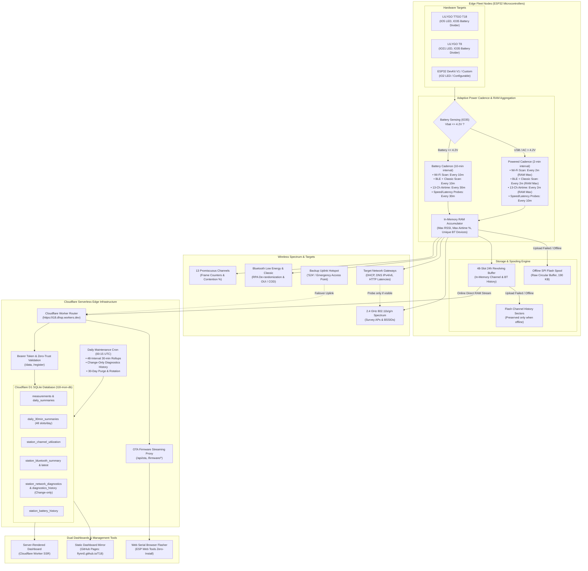

# flynn0/T18

[](https://github.com/flynn0/T18/releases)
[](https://opensource.org/licenses/Apache-2.0)
[](https://t18.dhsp.workers.dev/)
[](https://flynn0.github.io/T18/)

> Autonomous Wi-Fi Spectrum, Latency & Bluetooth Telemetry Fleet Node for ESP32 (LILYGO T18 & T8) with Cloudflare Worker, D1 SQLite Database, and GitHub Pages.

**Live Telemetry Dashboards & Web Installer**:
- 🌐 **Cloudflare Edge Dashboard**: [https://t18.dhsp.workers.dev/](https://t18.dhsp.workers.dev/)
- 📄 **GitHub Pages Mirror**: [https://flynn0.github.io/T18/](https://flynn0.github.io/T18/)
- ⚡ **In-Browser ESP32 Web Flasher**: [https://t18.dhsp.workers.dev/?flash=1](https://t18.dhsp.workers.dev/?flash=1) or [https://flynn0.github.io/T18/?flash=1](https://flynn0.github.io/T18/?flash=1)

---

## Architecture Overview



---

## Power-Aware Measurement Cadence Matrix

To maximize battery runtime on single-cell 18650 LiPo cells while delivering high-resolution spectrum telemetry, the firmware dynamically selects measurement cadences based on voltage sensed on **IO35**:

| Measurement Task | Battery Powered ($\le 4.20\text{ V}$) | USB / AC Powered ($> 4.20\text{ V}$ / No Bat) | RAM Storage & Rollup Invariant |
| :--- | :---: | :---: | :--- |
| **1) Wi-Fi Spectrum Scan** | Every 10 minutes | Every 2 minutes | Peak RSSI & quality accumulated in RAM per 10m window |
| **2) BLE & Classic Bluetooth Scan** | Every 10 minutes | Every 2 minutes | Max unique BLE & Classic BT devices accumulated in RAM |
| **3) 13-Channel Airtime Utilization** | Every 30 minutes | Every 2 minutes | Max airtime % across 13 channels accumulated in RAM |
| **4) Station Speed & Latency Probes** | Every 30 minutes *(Visible APs Only)* | Every 10 minutes *(Visible APs Only)* | Gateway, DHCP, DNS, and HTTP latency probes |
| **Telemetry Upload Attempt** | Every 10 minutes *(If AP or S24 visible)* | Every 10 minutes *(If AP or S24 visible)* | Directly transmitted from RAM (Zero flash wear when online) |
| **Flash Persistence** | Offline only (30-min buffer + spool) | Offline only (30-min buffer + spool) | No flash writes when telemetry upload succeeds |

---

## Key Architectural Features

- **Settings & Fleet Management Console**:
  Password-protected administrative suite with cryptographically signed HMAC-SHA256 session tokens. Enables operators to configure station descriptions, switch nodes between stable and canary OTA release tracks, pin explicit firmware versions, decommission nodes, execute selective historical data cleanups, and inspect live Cloudflare D1 table storage breakdown and 52-week activity heatmaps.
- **24-Hour Station Reliability Timeline (48 × 30-Minute Intervals)**:
  Embedded inside each monitored network card, providing instant visual health audits over the preceding 24 hours categorized by health status: 100% healthy (green), HTTP probe timeout (purple), DNS resolution timeout (amber), gateway RTT timeout (orange), DHCP lease timeout (red), association failure (charcoal), or idle (gray).
- **In-Browser Web Serial Firmware Flasher**:
  Zero-install browser flashing leveraging the Web Serial API and ESP Web Tools. Enables operators to flash compiled universal firmware, partition tables, and bootloaders directly to ESP32 nodes over USB with real-time progress and serial console logs from Google Chrome, Microsoft Edge, Brave, or Opera without installing local toolchains or Python.
- **Serverless Edge Storage & Analytics**:
  All telemetry cycles, spectrum scans, channel congestion metrics, and daily rollups are stored in **Cloudflare D1** (`t18-mon-db`). Automated daily cron triggers aggregate 24-hour summaries and enforce 30-day raw data retention.
- **Hardware Targets: LILYGO T18 & T8 with IO35 Voltage Sensing**:
  Tailored out-of-the-box for the **LILYGO TTGO T18 (T-Energy v3.0)**, while also fully supporting the **LILYGO T8**, ESP32 DevKit V1, and custom boards:
  - **LILYGO T18**: Status LED on **GPIO 5**, battery ADC on **GPIO 35** via 100kΩ/100kΩ divider (ratio 0.50, $V_{\text{bat}} = 2.0 \times V_{\text{pin}}$).
  - **LILYGO T8**: Status LED on **GPIO 21**, battery ADC on **GPIO 35** via 100kΩ/100kΩ divider.
  - **ESP32 DevKit V1**: Status LED on **GPIO 2**, battery monitoring disabled.
- **2.4 GHz Bluetooth Low Energy (BLE) Spectrum Survey**:
  Sequential Bluetooth Low Energy (BLE) scans during every cycle. Employs advanced advertising payload de-randomization (Apple Find My/AirTag, iBeacon, Eddystone, Tile, Samsung/Google continuity) to track true physical device presence and RF contention without MAC address inflation, with unique BLE counts persisted directly into 24-hour local flash storage.
- **Promiscuous Mode Channel Contention Profiling & LED Feedback**:
  Measures all 13 channels during boot/wake with dwell times using ESP-IDF promiscuous mode. Provides dynamic LED feedback (solid during channel dwell, 100 ms off during transition) and non-blocking BOOT button monitoring to enter the setup portal immediately.
- **Backup Hotspot Internet Failover**:
  Automatic detection of backup AP (e.g. "S24"). If primary monitored networks lack internet connectivity or fail to upload telemetry, the station automatically routes data through the backup uplink to prevent data loss.
- **Over-The-Air (OTA) Updates**:
  Automated edge OTA updates (`/api/ota`) with zero-redirect binary streaming proxies (`/api/ota/download/:filename`) backed by GitHub Releases and Cloudflare R2, with strict SemVer downgrade protection and canary routing.
- **Local Network & Dual-Stack Diagnostics**:
  Gateway TCP SYN-ACK latency, IPv4 vs. IPv6 DNS resolution benchmarking, captive portal HTTP canary hijacking detection, and automated daily firewall audits.
- **Zero-Flash-Wear Telemetry & Raw Spooling**:
  Normal telemetry cycles transmit directly from memory without touching flash. During offline periods, records are safely buffered into a dedicated 190 KB raw SPI flash binary circular spool partition (`raw_spool`).

---

## Hardware Pinout Reference

| Target Board | Status LED Pin | Battery ADC Pin (Divider) | BOOT Button | Default Preset |
| :--- | :---: | :---: | :---: | :--- |
| **LILYGO T18** *(Default)* | **GPIO 5** | **GPIO 35** (100k/100k, 0.50f) | **GPIO 0** | `BOARD_T18` |
| **LILYGO T8** | **GPIO 21** | **GPIO 35** (100k/100k, 0.50f) | **GPIO 0** | `BOARD_T8` |
| **ESP32 DevKit V1** | **GPIO 2** | N/A | **GPIO 0** | `BOARD_DEVKIT` |
| **Custom** | Configurable | Configurable | **GPIO 0** | `BOARD_CUSTOM` |

- **Battery Voltage Calculation**:
  On both T18 and T8, the battery voltage is measured on **IO35** using the onboard 100kΩ / 100kΩ resistor divider:
  $$V_{\text{battery}} = \frac{V_{\text{ADC}}}{0.50} = 2.0 \times V_{\text{ADC}}$$

---

## Firmware Build & Flashing

### Option A: In-Browser Web Flasher (Zero-Install — Recommended)
Flash pre-compiled universal firmware directly to any ESP32 board over USB using your web browser:

1. **Open the Web Flasher**:
   - 🌐 [https://t18.dhsp.workers.dev/?flash=1](https://t18.dhsp.workers.dev/?flash=1) (Cloudflare Edge)
   - 📄 [https://flynn0.github.io/T18/?flash=1](https://flynn0.github.io/T18/?flash=1) (GitHub Pages Mirror)
   - Or click **⚡ Flash Device** in the top navigation header of any dashboard view.
2. **Connect your ESP32** via a USB data cable to your desktop computer.
3. Supported browsers: **Google Chrome**, **Microsoft Edge**, **Brave**, or **Opera** on desktop (requires Web Serial API over HTTPS).
4. Click **⚡ Connect ESP32 & Install Firmware** and select your board's serial port (`CP210x`, `CH340`, or `USB JTAG`).
5. Choose **Install T18 Monitor** and check **Erase device** for a fresh clean installation.
6. The installer downloads the binary image, writes all partition tables and application slots, and verifies flash in real-time.

> **Troubleshooting Connection**: If the browser times out or cannot synchronize with the ESP32 chip, press and hold the **BOOT (GPIO 0)** button on your board while clicking Connect, then release it once erasing/flashing begins.

---

### Option B: Pre-Compiled Binary Flashing (`esptool.py`)
If you prefer command-line flashing without compiling from source, download the compiled binaries from the Web Flasher dialog or [GitHub Releases](https://github.com/flynn0/T18/releases/latest):

- `firmware.bin` (Application — offset `0x10000`)
- `partitions.bin` (Partition Table — offset `0x8000`)
- `bootloader.bin` (Second Stage Bootloader — offset `0x1000`)
- `boot_app0.bin` (OTA Data Initializer — offset `0xe000`)
- `firmware-esp32-merged.bin` (Unified all-in-one image — offset `0x0`)

**Multi-part Flash**:
```bash
esptool.py --chip esp32 --baud 921600 write_flash \
  0x1000 bootloader.bin \
  0x8000 partitions.bin \
  0xe000 boot_app0.bin \
  0x10000 firmware.bin
```

**Single Unified Binary Flash**:
```bash
esptool.py --chip esp32 --baud 921600 write_flash 0x0 firmware-esp32-merged.bin
```

---

### Option C: PlatformIO (Source Build)
```bash
cd firmware

# Build and upload for ESP32 Universal Target
pio run -e esp32dev -t upload

# Monitor Serial Output (115200 baud)
pio device monitor -b 115200
```

---

### Option D: Arduino IDE (Source Build)
1. Open Arduino IDE.
2. Open [`firmware/T18/T18.ino`](firmware/T18/T18.ino).
3. Under **Tools > Board**, select **ESP32 Dev Module**.
4. Set **Partition Scheme** to **Minimal SPIFFS (Large APPS with OTA)**.
5. Install the **ArduinoJson** library (v7.x).
6. Click **Upload**.

---

## Cloudflare Worker & D1 Setup

### 1. Worker Configuration
- **Worker Name**: `t18` (accessible at `https://t18.dhsp.workers.dev`)
- **D1 Database**: `t18-mon-db` (`9526b47c-4fa7-41cc-8cc5-ba5b2bd8cf4f`)

### 2. Deploy Worker & Apply Migrations
```bash
cd worker
npm install
npm run d1:migrate:remote
npm run build:docs
npx wrangler deploy --keep-vars
```

---

## API Endpoints

### Public & Telemetry APIs
- `GET /` — Responsive Server-Rendered Telemetry Dashboard
- `GET /manifest.json` — ESP Web Tools flasher manifest
- `GET /firmware/:filename` — Binary distribution for Web Serial flashing
- `POST /register` — Zero-Trust Station Token Provisioning
- `POST /data` — Ingestion endpoint for 10-minute telemetry cycles
- `GET /api/stations` — Public station list and health status
- `GET /api/station/:id` — Detailed station metrics, Bluetooth activity, history, and diagnostics
- `GET /api/ota` — OTA check endpoint for firmware update dispatch
- `GET /api/ota/download/:filename` — Direct binary streaming proxy for ESP32 OTA updates
- `GET /api/export` — Telemetry export in CSV or JSON format

### Administrative APIs (Protected by HMAC Bearer Token)
- `POST /api/admin/login` — Administrator authentication & session issuance
- `GET /api/admin/verify` — Admin session validation
- `GET /api/admin/overview` — D1 storage metrics, table row counts, operational span, and yearly activity heatmap
- `POST /api/admin/station/update` — Update node description, canary OTA flag, and target firmware version
- `POST /api/admin/station/delete` — Decommission node with optional telemetry purge
- `POST /api/admin/data/delete` — Timeframe-based raw measurement and survey pruning

---

## License

This project is licensed under the **Apache License 2.0** — see the [LICENSE](LICENSE) file for details.
